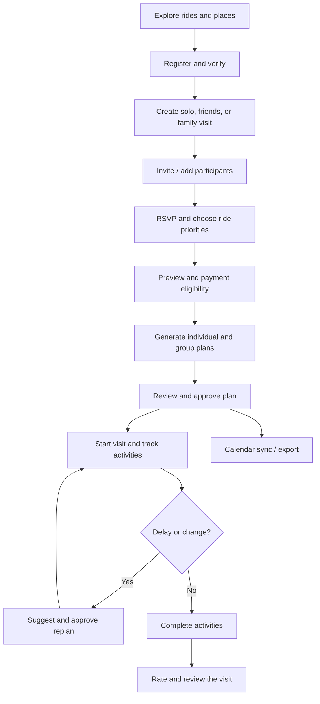
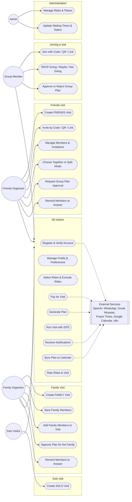
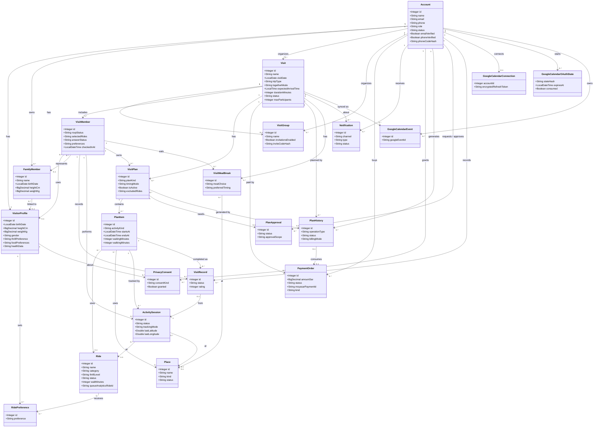
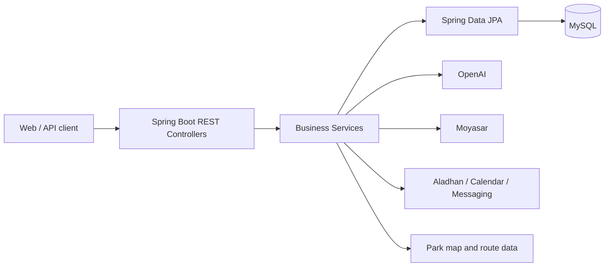
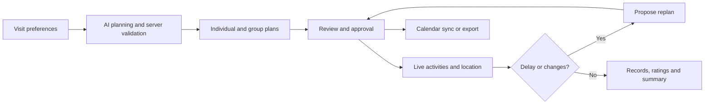

<div align="center">


# SIKKA | سكة 🎢

### Your Qiddiya day, planned in minutes.

**An AI-powered visit planner for Six Flags Qiddiya — built for solo visitors, friends, and families.**

[](https://www.java.com/)
[](https://spring.io/projects/spring-boot)
[](https://www.mysql.com/)
[](https://railway.com/)

[Overview](#overview) · [Features](#features) · [User Journey](#user-journey) · [Architecture](#architecture) · [API Overview](#api-overview) · [Live Website](https://sikka.up.railway.app/#home) · [API Documentation](docs/API-DOCUMENTATION.md) · [Contributions](#abdulaziz-shafae-contributions)

</div>

---

## Overview

**SIKKA (سكة)** helps visitors organize a full day at **Six Flags Qiddiya**. Instead of managing ride choices, queue times, walking distances, meals, and group decisions in separate places, Sikka brings them together in a coordinated visit plan.

The organizer creates a visit; friends or family participate and select rides; the backend checks ride restrictions; AI assists with individual and group itineraries; and the app supports approvals, progress tracking, GPS-assisted activities, alerts, and post-visit ratings.

> **Scope:** Sikka plans park visits. It does **not** sell Six Flags admission tickets. Paid functionality refers to Sikka's planning service.

## The Problem & Our Solution

| Visitor challenge | Sikka's approach |
|---|---|
| Different interests and ride restrictions | Personal profiles, ride priorities, and eligibility checks |
| Difficult group coordination | Solo, friends, and family visits; invitations and participant management |
| Time lost to queues and walking | Itineraries informed by available waiting-time and map data |
| Meal and prayer breaks are overlooked | Scheduled dining breaks and prayer times |
| Schedules become outdated during the visit | Completion tracking, delays, and proposed replanning |
| Hard to recall what was completed | Per-member records, ratings, and progress summaries |

## Technology Stack

| Layer | Technologies / integrations |
|---|---|
| Backend | Java 17, Spring Boot 4.1.1, REST controllers |
| Persistence | MySQL 8, Spring Data JPA / Hibernate |
| Authentication | Spring Security, session authentication, BCrypt |
| AI planning | OpenAI API, server-side itinerary validation |
| Park data & maps | Ride / place catalogue, park map and walking routes |
| Prayer times | Aladhan API |
| Payments | Moyasar sandbox, backend-side payment verification |
| Communication | Gmail SMTP, UltraMsg WhatsApp, n8n webhooks |
| Calendar | Google Calendar OAuth, manual Google link, Apple `.ics` export |
| QR invitations | ZXing |
| Frontend (separate repository) | Next.js 16, React 19, TypeScript, Tailwind CSS |
| Testing & delivery | JUnit, Mockito, Maven Wrapper, Docker, GitHub Actions, Railway |

**Repository scope:** This repository contains the Spring Boot backend. Do not assume a React frontend is included in this repository or that every external integration is live in production.

## External APIs & Integrations

| Service | Purpose | Implementation area |
|---|---|---|
| OpenAI API | AI-assisted individual/group plans and replanning | Planning services |
| Aladhan API | Prayer time lookup for scheduling | `PrayerTimeService` |
| Google Calendar API | OAuth connection and synchronization of approved plans | Calendar services |
| Gmail SMTP | Email verification and account messages | Email services |
| UltraMsg (WhatsApp) | Phone verification and messages | WhatsApp services |
| Moyasar API | Server-side payment confirmation | `MoyasarService` |
| n8n webhooks | Workflow-driven notification delivery | `N8nNotificationService` |

Apple Calendar `.ics` exports, ZXing QR generation, browser GPS and local park routing are **not separate external REST API providers**. Provider setup and actual live delivery depend on credentials and deployment configuration.

## Features

### Accounts, profiles and group visits
- Account registration, email and optional phone verification, password recovery, authenticated profile management.
- Visit types: `SOLO`, `FRIENDS`, and `FAMILY`.
- Invitations through a code, QR code, or shareable link; RSVP and selected ride priorities.
- Family member profiles managed by the visit organizer.
- Free-visit allowance and server-verified payment for additional planning.

### AI-assisted planning
- Individual and coordinated group itineraries.
- Three ride priorities: `MUST_RIDE`, `PREFERRED`, `OPTIONAL`.
- Eligibility and itinerary constraints evaluated by the backend — AI output is not a substitute for official ride safety rules.
- Ride availability, waiting times, walking routes, meals, snacks, and prayer-time considerations.
- Plan approval, subgroup coordination, meeting points, and proposed replanning.

### During and after the visit
- Activity sessions started manually or through GPS-assisted flows.
- Family activity completion and per-member visit records.
- Delay notifications, current / next activities, and visit progress.
- Optional ratings and reviews for completed experiences.
- Calendar synchronization and export.

## User Journey


## Use Case Diagram

Sikka has three visit types, so the actors are separated by the type of visit they run.



| Actor | Visit type | What is different |
|---|---|---|
| **Solo Visitor** | SOLO | No group and no invitations; one individual plan |
| **Family Organizer** | FAMILY | Adds saved family members (children and adults) to the visit, chooses the rides for the family, reminds members to answer, and approves the plan for them |
| **Friends Organizer** | FRIENDS | Creates the group, invites by code / QR / link, chooses together or split mode, reminds members to answer, requests group approval |
| **Group Member** | FRIENDS / FAMILY | Joins an existing visit, answers RSVP, selects rides, approves or rejects plans |
| **Admin** | None | Manages the ride and place catalogue |

---

## Class Diagram

The diagram shows the **22 entities** of Sikka (key fields only) and their relationships, taken from the JPA mappings in the `Model/` package.



---

## Architecture



The Java code follows the project structure:

```text
src/main/java/com/example/sikka/
├── Advice/       # Exception handling
├── Api/          # Common API response / exception
├── Config/       # Security and configuration
├── Controller/   # REST endpoints
├── DtoIn/        # Request DTOs
├── DtoOut/       # Response DTOs
├── Model/        # JPA entities
├── Repository/   # Database access
└── Service/      # Business logic and integrations
```

## API Overview

The backend currently declares **170 REST endpoints across 22 controllers** on the GitHub `main` branch (28 October 2026). These are source-code route counts, not a claim that every external integration has passed live end-to-end testing.

**Contribution accounting:** Each Model belongs to its original Git creator. Each API endpoint is credited to the developer who first implemented that route, even when it appears in another team member's Controller. Subsequent shared fixes and integrations are listed separately; contributor-specific endpoint totals will be published only after the route-level Git audit is complete.

**Full API reference:** [API Documentation — 170 routes across 22 controllers](docs/API-DOCUMENTATION.md).

**Project links:** [SIKKA website](https://sikka.up.railway.app/#home) · [Backend (SIKKA-final)](https://github.com/Abdulaziz-Shafae/SIKKA-final).


## Data Model

The project currently contains **22 JPA models** across the following areas.

The project contains core models for visitors, visits, plans, park facilities, payments, messaging, and calendar sync. Examples include:

| Domain | Models |
|---|---|
| Users & visits | `Account`, `VisitorProfile`, `FamilyMember`, `Visit`, `VisitGroup`, `VisitMember` |
| Planning | `VisitPlan`, `PlanItem`, `PlanApproval`, `PlanHistory`, `VisitMealBreak` |
| Live execution | `ActivitySession`, `VisitRecord`, `Notification` |
| Park & billing | `Ride`, `Place`, `RidePreference`, `PaymentOrder`, `PrivacyConsent` |
| Calendar integration | `GoogleCalendarConnection`, `GoogleCalendarEvent`, `GoogleCalendarOAuthState` |

The current model inventory extends beyond the original **15-model team allocation**. Always use the `Model/` package for the current entity inventory rather than relying on the older ERD alone.


## Abdulaziz Shafae Contributions

**Core entities:** VisitPlan, PlanItem, PlanApproval, PlanHistory, VisitRecord, ActivitySession, Notification, GoogleCalendarConnection, GoogleCalendarEvent, GoogleCalendarOAuthState.

**Main work:** AI-driven individual/group planning, ride priorities and scheduling constraints, plan approval, replanning, subgroup coordination, live activity tracking, GPS-assisted actions, completion records, ratings, summaries and progress.

**AI:** OpenAI-assisted generation and replanning, with backend validation of available rides, time budgets, exclusions, queue estimates and prayer scheduling.

**Integrations:** Google Calendar OAuth/synchronization and Apple `.ics` exports; map-route and prayer-time data consumed during scheduling.

**Notification work:** in-app notifications, read state, delay checks and responses. n8n delivery services were introduced by Nawaf, so this integration is shared work rather than solely credited here.

**Frontend & queue analytics projects:**

- **[SIKKA Frontend](https://github.com/Abdulaziz-Shafae/SIKKA-front):** Next.js, React and TypeScript web application integrating the park experience with backend services.
- **[Queue Analytics & Data Collection](https://github.com/Abdulaziz-Shafae/Queue_Analytics):** Separate repository for collecting and analyzing ride-queue data used by the planning ecosystem.

**Additional contributions:** shared visit/member endpoint implementation, cross-module integration, merge resolution, and backend regression and integration testing.

---

## Flow 2: AI Planning & Live Visit (Abdulaziz Shafae)

**Personal contribution accounting:** Only endpoints first introduced by this contributor in Git count toward their individual total, regardless of controller or model ownership. The tables below document related API routes and do **not** claim all were authored by this contributor. A fully verified personal total is intentionally not published until route-by-route Git attribution is complete.

### 1. Flow Brief

Flow 2 creates and manages itineraries after visitor choices have been collected, coordinates plan approval, tracks ongoing activities, and produces per-visitor progress and history. The approved itinerary remains the reference while a replan is pending.



### 2. Models and Relationships

| Model | Purpose | Key relationships |
|---|---|---|
| `VisitPlan` | Individual/group itinerary and plan state | Belongs to `Visit`; contains `PlanItem`; approval and history associations |
| `PlanItem` | Ride, place, break or meeting point | Belongs to `VisitPlan`; optional `Ride` or `Place` |
| `PlanApproval` | Approval or rejection of a plan | References `VisitPlan` and accounts |
| `PlanHistory` | Planning attempts and outcomes | Associated with visits, accounts and generated plans |
| `ActivitySession` | GPS/manual execution tracking | Associated with visit participants and plan items |
| `VisitRecord` | Activity completion, skip and rating | Associated with visit members and plan items |
| `Notification` | In-app events, status and delay handling | Delivered to an account, optionally related to a visit |
| `GoogleCalendarConnection` | OAuth connection state | Owned by account |
| `GoogleCalendarEvent` | Synced external calendar events | Associated with account and visit |
| `GoogleCalendarOAuthState` | One-time OAuth state | Associated with account |

**Cross-module dependencies:** Planning reads rides/places/maps (Nawaf's domain) and visits/members (Mohammed's domain). `VisitMealBreak` belongs to Nawaf by Model creation history and is coordinated with planning services.

**Business rules**

- Plan generation uses ride priorities (`MUST_RIDE`, `PREFERRED`, `OPTIONAL`), exclusions, and available schedule constraints.
- Solo, friends and family itineraries may differ in participant selection and approvals.
- Proposed replanning does not silently replace the current approved plan.
- GPS/manual activity tracking and records support per-member completion.
- Calendar export and sync are based on eligible/approved visit scheduling.
- Integration availability and provider credentials affect live delivery; code presence alone is not proof of successful production execution.

### 3. Related Controller Routes

The following inventory documents routes under Controllers associated with Abdulaziz's Models. It includes basic read/write operations and business endpoints, **not a separate API reference with schemas, authentication requirements and request/response examples**.

**VisitPlanController — 15 routes**

| Method | Endpoint | Purpose |
|---|---|---|
| GET | `/api/v1/visit-plan/get/map-route/{visitPlanId}` | Planned map route |
| GET | `/api/v1/visit-plan/get/plans/{visitId}` | Visit plans |
| GET | `/api/v1/visit-plan/get/details/{visitPlanId}` | Plan details |
| POST | `/api/v1/visit-plan/create/individual/{visitId}` | Create individual plan |
| POST | `/api/v1/visit-plan/create/group/{visitId}` | Create group plan |
| DELETE | `/api/v1/visit-plan/delete/{visitPlanId}` | Delete plan |
| GET | `/api/v1/visit-plan/get/my-individual-plan/{visitId}` | Individual plan |
| GET | `/api/v1/visit-plan/get/approved-group-plan/{visitId}` | Approved group plan |
| GET | `/api/v1/visit-plan/get/pending-group-plan/{visitId}` | Pending group plan |
| GET | `/api/v1/visit-plan/meeting-points/{visitId}` | Group meeting points |
| GET | `/api/v1/visit-plan/next-activity/{visitId}` | Next activity |
| GET | `/api/v1/visit-plan/my-subgroup/{visitId}` | Member subgroup |
| POST | `/api/v1/visit-plan/generate/{visitId}` | Generate AI plans |
| POST | `/api/v1/visit-plan/regenerate/group/{visitId}` | Regenerate group plan |
| POST | `/api/v1/visit-plan/suggest-replan/{visitId}` | Suggest replanning |

**PlanItemController — 3 routes**

| Method | Endpoint | Purpose |
|---|---|---|
| GET | `/api/v1/plan-item/get/items/{visitPlanId}` | List itinerary items |
| GET | `/api/v1/plan-item/get/details/{planItemId}` | Itinerary item details |
| PUT | `/api/v1/plan-item/update/preferences` | Update plan item preferences |

**PlanApprovalController — 4 routes**

| Method | Endpoint | Purpose |
|---|---|---|
| GET | `/api/v1/plan-approval/get/{visitPlanId}` | Approval status |
| POST | `/api/v1/plan-approval/create/{visitPlanId}` | Create approval request |
| PUT | `/api/v1/plan-approval/approve` | Approve proposal |
| PUT | `/api/v1/plan-approval/reject` | Reject proposal |

**PlanHistoryController — 2 routes**

| Method | Endpoint | Purpose |
|---|---|---|
| GET | `/api/v1/plan-history/my-history` | Planning history |
| GET | `/api/v1/plan-history/details/{planHistoryId}` | Planning operation details |

**VisitRecordController — 8 routes**

| Method | Endpoint | Purpose |
|---|---|---|
| GET | `/api/v1/visit-record/get/my-records/{visitId}` | My visit records |
| POST | `/api/v1/visit-record/complete/{visitId}` | Record completion |
| POST | `/api/v1/visit-record/skip/{visitId}` | Record skipped activity |
| PUT | `/api/v1/visit-record/update/complete` | Correct completion |
| PUT | `/api/v1/visit-record/update/skip` | Correct skip |
| PUT | `/api/v1/visit-record/rate` | Rate record |
| GET | `/api/v1/visit-record/visit-summary/{visitId}` | Visit summary |
| GET | `/api/v1/visit-record/progress/{visitId}` | Visit progress |

**ActivitySessionController — 9 routes**

| Method | Endpoint | Purpose |
|---|---|---|
| GET | `/api/v1/activity-session/history/{visitId}` | Activity history |
| GET | `/api/v1/activity-session/current/{visitId}` | Current activities |
| POST | `/api/v1/activity-session/start/manual/{visitMemberId}/{planItemId}` | Start manually |
| POST | `/api/v1/activity-session/complete/{activitySessionId}` | Complete activity |
| PUT | `/api/v1/activity-session/rate/{activitySessionId}` | Rate activity |
| PUT | `/api/v1/activity-session/location/{visitId}` | Update activity location |
| POST | `/api/v1/activity-session/start/gps/{visitMemberId}/{planItemId}` | GPS-assisted activity start |
| POST | `/api/v1/activity-session/start/manual/family/{planItemId}` | Start family activity |
| POST | `/api/v1/activity-session/complete/family/{activitySessionId}` | Complete family activity |

**NotificationController — 7 routes**

| Method | Endpoint | Purpose |
|---|---|---|
| GET | `/api/v1/notification/get/my-notifications` | Notification inbox |
| GET | `/api/v1/notification/get/details/{notificationId}` | Notification details |
| DELETE | `/api/v1/notification/delete/{notificationId}` | Delete notification |
| PUT | `/api/v1/notification/read/{notificationId}` | Mark as read |
| GET | `/api/v1/notification/unread-count` | Unread notification count |
| PUT | `/api/v1/notification/respond-delay/{notificationId}` | Respond to delay prompt |
| POST | `/api/v1/notification/check-delay/{activitySessionId}` | Check session delay |

**GoogleCalendarController — 8 routes**

| Method | Endpoint | Purpose |
|---|---|---|
| GET | `/api/v1/google-calendar/manual/{visitId}` | Google Calendar manual export |
| GET | `/api/v1/google-calendar/apple/{visitId}` | Apple Calendar .ics export |
| GET | `/api/v1/google-calendar/oauth/connect` | Begin OAuth connection |
| GET | `/api/v1/google-calendar/oauth/callback` | OAuth callback |
| GET | `/api/v1/google-calendar/oauth/status` | Connection status |
| POST | `/api/v1/google-calendar/sync/{visitId}` | Sync approved plan |
| DELETE | `/api/v1/google-calendar/sync/cancelled/{visitId}` | Remove cancelled visit event |
| DELETE | `/api/v1/google-calendar/oauth/disconnect` | Disconnect Calendar |
### 4. External APIs and Technologies

| Service | Purpose | Implementation |
|---|---|---|
| OpenAI API | Individual/group planning and proposed replans | AI planning services |
| Google Calendar API | OAuth, synchronization and cancellation cleanup | `GoogleCalendarService`, `GoogleCalendarOAuthService` |
| Apple Calendar | Local `.ics` export (not a separate external API) | `GoogleCalendarController` |
| Aladhan API | Prayer-aware schedules | `PrayerTimeService` |
| GPS and park map routing | Activity tracking and walking estimates (not a third-party REST API here) | Activity and map services |
| n8n webhook | Shared notification delivery integration; service files originally added by Nawaf | Notification services |

### 5. Tests and Validation

The repository includes targeted planning and cross-flow checks, including `ServerItineraryServiceTest`, `TogetherReplanRegressionTest`, `PlanApprovalAvailabilityTest`, `CalendarSyncOnApprovalTest`, `ArrivalPrayerScheduleTest`, and `VisitPlanMapServiceTest`. These are source files present in the repository; their existence does not by itself confirm a current CI pass or successful external-provider calls.

---

<div align="center">

**SIKKA | سكة** · Your Qiddiya day, planned in minutes.

</div>
