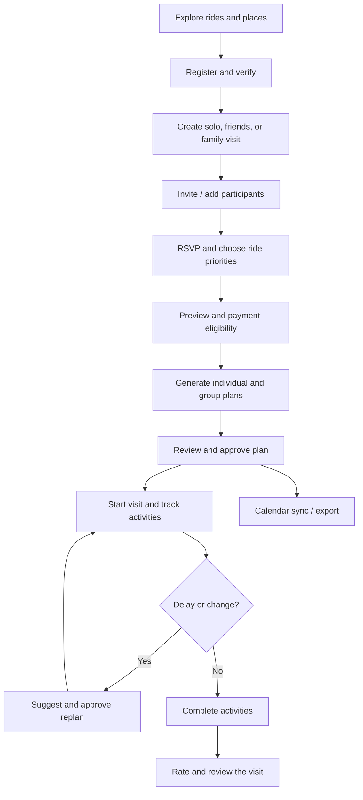
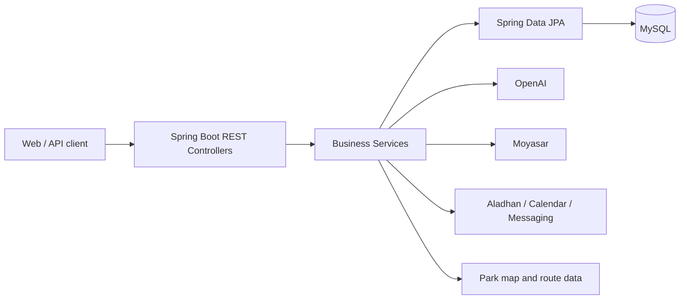

<div align="center">


# SIKKA | سكة 🎢

### Your Qiddiya day, planned in minutes.

**An AI-powered visit planner for Six Flags Qiddiya — built for solo visitors, friends, and families.**

[](https://www.java.com/)
[](https://spring.io/projects/spring-boot)
[](https://www.mysql.com/)
[](https://railway.com/)

[Overview](#overview) · [Features](#features) · [User Journey](#user-journey) · [API Inventory](#api-inventory) · [Local Setup](#run-locally) · [Deployment](#railway-deployment) · [Contributions](#abdulaziz-shafae-contributions) · [Team](#team)

</div>

---

## Overview

**SIKKA (سكة)** helps visitors organize a full day at **Six Flags Qiddiya**. Instead of managing ride choices, queue times, walking distances, meals, and group decisions in separate places, Sikka brings them together in a coordinated visit plan.

The organizer creates a visit; friends or family participate and select rides; the backend checks ride restrictions; AI assists with individual and group itineraries; and the app supports approvals, progress tracking, GPS-assisted activities, alerts, and post-visit ratings.

> **Scope:** Sikka plans park visits. It does **not** sell Six Flags admission tickets. Paid functionality refers to Sikka's planning service.

## The Problem & Our Solution

| Visitor challenge | Sikka's approach |
|---|---|
| Different interests and ride restrictions | Personal profiles, ride priorities, and eligibility checks |
| Difficult group coordination | Solo, friends, and family visits; invitations and participant management |
| Time lost to queues and walking | Itineraries informed by available waiting-time and map data |
| Meal and prayer breaks are overlooked | Scheduled dining breaks and prayer times |
| Schedules become outdated during the visit | Completion tracking, delays, and proposed replanning |
| Hard to recall what was completed | Per-member records, ratings, and progress summaries |

## Technology Stack

| Layer | Technologies / integrations |
|---|---|
| Backend | Java 17, Spring Boot 4.1, REST controllers |
| Persistence | MySQL 8, Spring Data JPA / Hibernate |
| Authentication | Spring Security, session authentication, BCrypt |
| AI planning | OpenAI API, server-side itinerary validation |
| Park data & maps | Ride / place catalogue, park map and walking routes |
| Prayer times | Aladhan API |
| Payments | Moyasar sandbox, backend-side payment verification |
| Communication | Gmail SMTP, UltraMsg WhatsApp, n8n webhooks |
| Calendar | Google Calendar OAuth, manual Google link, Apple `.ics` export |
| QR invitations | ZXing |
| Testing & delivery | JUnit, Mockito, Maven Wrapper, Docker, GitHub Actions, Railway |

**Repository scope:** This repository contains the Spring Boot backend. Do not assume a React frontend is included in this repository or that every external integration is live in production.

## External APIs & Integrations

| Service | Purpose | Implementation area |
|---|---|---|
| OpenAI API | AI-assisted individual/group plans and replanning | Planning services |
| Aladhan API | Prayer time lookup for scheduling | `PrayerTimeService` |
| Google Calendar API | OAuth connection and synchronization of approved plans | Calendar services |
| Gmail SMTP | Email verification and account messages | Email services |
| UltraMsg (WhatsApp) | Phone verification and messages | WhatsApp services |
| Moyasar API | Server-side payment confirmation | `MoyasarService` |
| n8n webhooks | Workflow-driven notification delivery | `N8nNotificationService` |

Apple Calendar `.ics` exports, ZXing QR generation, browser GPS and local park routing are **not separate external REST API providers**. Provider setup and actual live delivery depend on credentials and deployment configuration.

## Features

### Accounts, profiles and group visits
- Account registration, email and optional phone verification, password recovery, authenticated profile management.
- Visit types: `SOLO`, `FRIENDS`, and `FAMILY`.
- Invitations through a code, QR code, or shareable link; RSVP and selected ride priorities.
- Family member profiles managed by the visit organizer.
- Free-visit allowance and server-verified payment for additional planning.

### AI-assisted planning
- Individual and coordinated group itineraries.
- Three ride priorities: `MUST_RIDE`, `PREFERRED`, `OPTIONAL`.
- Eligibility and itinerary constraints evaluated by the backend — AI output is not a substitute for official ride safety rules.
- Ride availability, waiting times, walking routes, meals, snacks, and prayer-time considerations.
- Plan approval, subgroup coordination, meeting points, and proposed replanning.

### During and after the visit
- Activity sessions started manually or through GPS-assisted flows.
- Family activity completion and per-member visit records.
- Delay notifications, current / next activities, and visit progress.
- Optional ratings and reviews for completed experiences.
- Calendar synchronization and export.

## User Journey



## Architecture



The Java code follows the project structure:

```text
src/main/java/com/example/sikka/
├── Advice/       # Exception handling
├── Api/          # Common API response / exception
├── Config/       # Security and configuration
├── Controller/   # REST endpoints
├── DtoIn/        # Request DTOs
├── DtoOut/       # Response DTOs
├── Model/        # JPA entities
├── Repository/   # Database access
└── Service/      # Business logic and integrations
```

## API Inventory

**168 declared HTTP endpoints across 22 controllers**, counted directly from `@GetMapping`, `@PostMapping`, `@PutMapping`, and `@DeleteMapping` declarations in the `main` branch on **27 October 2026**. Each route counts once. The breakdown below is a **controller / Model ownership view**, not a final individual authorship count. For contributor credit, each endpoint must be assigned to the Git author who first implemented that specific route, including routes added to another developer’s controller. This route-level attribution is still under review. `AuthController` follows `Account`; `MapController` follows the park models; `GoogleCalendarController` follows its calendar models.

| Model / controller ownership group | Controllers | Routes in group |
|---|---:|---:|
| Mohammed — accounts, profiles, visits, groups, participants | 6 | **58** |
| Abdulaziz — AI planning, live visit, approvals, calendar, alerts | 8 | **56** |
| Nawaf — rides, map, places, preferences, privacy, payment orders, family members, meal breaks | 8 | **54** |
| **Total** | **22** | **168** |

### Flow 1 — Mohammed Turki · Before the visit

| Controller | API endpoints | Responsibilities |
|---|---:|---|
| `AccountController` | 6 | Account administration, registration, current account |
| `AuthController` | 6 | Verification and password recovery |
| `VisitorProfileController` | 6 | Visitor profile CRUD and personal profile |
| `VisitController` | 14 | Visit creation, preview, update, lifecycle, reuse |
| `VisitGroupController` | 9 | Group administration, invitations, QR and links |
| `VisitMemberController` | 17 | Joining, RSVP, ride selection, preferences, check-in |
| **Total** | **58** | |

### Flow 2 — Abdulaziz · Planning and live visit

| Controller | API endpoints | Responsibilities |
|---|---:|---|
| `VisitPlanController` | 15 | AI generation, individual/group plans, route and replanning |
| `PlanItemController` | 3 | Plan item lookup and preferences |
| `PlanApprovalController` | 4 | Approval creation and decisions |
| `PlanHistoryController` | 2 | Plan generation history |
| `VisitRecordController` | 8 | Completions, skips, ratings and progress |
| `ActivitySessionController` | 9 | Activity execution, GPS and family completion |
| `NotificationController` | 7 | Notifications, unread count and delay responses |
| `GoogleCalendarController` | 8 | Google OAuth/sync and Apple/Google calendar export |
| **Total** | **56** | |

### Flow 3 — Nawaf · Park data and payments

| Controller | API endpoints | Responsibilities |
|---|---:|---|
| `RideController` | 11 | Ride catalogue, filters, restrictions, status/waits |
| `PlaceController` | 6 | Restaurants and park facilities |
| `MapController` | 8 | Park map data, imports, points and routes |
| `RidePreferenceController` | 5 | Personal ride preferences |
| `PrivacyConsentController` | 4 | Privacy consents and withdrawal |
| `PaymentOrderController` | 5 | Payment-order creation, lookup and verification |
| `FamilyMemberController` | 5 | Saved family member management |
| `VisitMealBreakController` | 10 | Personal/shared meal breaks and restaurant choices |
| **Total** | **54** | |

> `FamilyMemberController` and `VisitMealBreakController` are counted under Nawaf because Nawaf originally created their models (Git commit `dd888312`). `PaymentOrderController` is also counted under Nawaf, while Mohammed contributed to its payment-verification implementation. The number **168** is the declared backend route count, **not** proof of successful end-to-end execution for every route.

### Representative endpoints

```http
POST /api/v1/account/register
POST /api/v1/auth/verify-email
POST /api/v1/visit/create
POST /api/v1/visit-member/join
PUT  /api/v1/visit-member/update-selected-rides/{visitId}
GET  /api/v1/ride/eligibility/{memberId}/{rideId}
POST /api/v1/visit-plan/generate/{visitId}
POST /api/v1/visit-plan/suggest-replan/{visitId}
PUT  /api/v1/plan-approval/approve
POST /api/v1/activity-session/complete/{activitySessionId}
GET  /api/v1/visit-record/progress/{visitId}
GET  /api/v1/map/get/data
GET  /api/v1/map/route/{fromType}/{fromId}/{toType}/{toId}
POST /api/v1/payment-order/confirm/{paymentOrderId}
POST /api/v1/google-calendar/sync/{visitId}
```

## Data Model

The project contains core models for visitors, visits, plans, park facilities, payments, messaging, and calendar sync. Examples include:

| Domain | Models |
|---|---|
| Users & visits | `Account`, `VisitorProfile`, `FamilyMember`, `Visit`, `VisitGroup`, `VisitMember` |
| Planning | `VisitPlan`, `PlanItem`, `PlanApproval`, `PlanHistory`, `VisitMealBreak` |
| Live execution | `ActivitySession`, `VisitRecord`, `Notification` |
| Park & billing | `Ride`, `Place`, `RidePreference`, `PaymentOrder`, `PrivacyConsent` |
| Calendar integration | `GoogleCalendarConnection`, `GoogleCalendarEvent`, `GoogleCalendarOAuthState` |

The project evolved beyond the original **15-model team allocation**. Always use the `Model/` package for the current entity inventory rather than relying on the older ERD alone.

## Run Locally

### Requirements

- Java 17 and a compatible JDK.
- MySQL 8.
- Maven Wrapper (already included).
- Environment credentials for the external integrations being exercised.

1. Clone the repository:

```bash
git clone https://github.com/Abdulaziz-Shafae/SIKKA.git
cd SIKKA
```

2. Create a local database:

```sql
CREATE DATABASE sikka;
```

3. Configure `src/main/resources/application.properties` through environment variables. The repository's documented local database URL uses **port 3307**; adjust your local MySQL port as needed. **Never commit provider secrets.** Example variable names:

```dotenv
SPRING_DATASOURCE_PASSWORD=your_database_password
MAIL_USERNAME=your_email
MAIL_PASSWORD=your_email_app_password
ULTRAMSG_INSTANCE_ID=your_instance_id
ULTRAMSG_TOKEN=your_token
MOYASAR_SECRET_KEY=your_moyasar_test_secret
OPENAI_API_KEY=your_api_key
GOOGLE_CALENDAR_CLIENT_ID=your_google_client_id
GOOGLE_CALENDAR_CLIENT_SECRET=your_google_client_secret
GOOGLE_CALENDAR_ENCRYPTION_KEY=your_encryption_key
SIKKA_N8N_URL=your_optional_webhook
SIKKA_N8N_KEY=your_optional_webhook_key
JOIN_URL=your_optional_public_invite_base_url
```

4. Start the API from the repository root:

```powershell
# Windows
.\mvnw.cmd spring-boot:run
```

```bash
# macOS / Linux
./mvnw spring-boot:run
```

5. Inspect a public endpoint (if the database and startup settings are configured):

```http
GET http://localhost:8080/api/v1/ride/get
```

> Some integrations require properly configured credentials, OAuth redirect URIs, or live service accounts. Do not treat a successful local startup as verification of all external workflows.

## Railway Deployment

Deployment is prepared for Railway using the repository's `Dockerfile`, `railway.json`, and production Spring profile.

- Build: multi-stage Maven / Java Docker image.
- Runtime: Spring Boot reads the assigned `PORT` and environment variables.
- Health check: `/api/v1/ride/get`.
- Database: configure the MySQL connection in Railway Variables.
- Secret keys: store in Railway service Variables, not source control.
- Set production hostnames, cookie security and OAuth callback URLs according to the deployed domain.

Railway deployment settings and successful third-party integration calls should be verified in the actual environment. **No real secrets belong in the README.**

## Testing & Verification

```powershell
# Windows: run all configured backend tests
.\mvnw.cmd test
```

```bash
# macOS / Linux
./mvnw test
```

Tests in the repository cover service constraints, web/controller contracts, planning rules, replanning regressions, shared-visit scenarios, calendar syncing, and deletion behavior. GitHub Actions includes a verification workflow; manual integration scenarios are tracked in [`SIKKA_TEST_PLAN.md`](SIKKA_TEST_PLAN.md).

**Verification boundaries:** This README inventories source-code endpoints, but does not claim that every API, GPS scenario, live queue feed, payment, n8n workflow, email, WhatsApp, OAuth callback, or frontend interaction has passed a production end-to-end test.

## Repository & Useful Links

- **Backend source:** [Abdulaziz-Shafae/SIKKA](https://github.com/Abdulaziz-Shafae/SIKKA)
- **Manual testing checklist:** [`SIKKA_TEST_PLAN.md`](SIKKA_TEST_PLAN.md)
- **Ride data sources and gaps:** [`docs/ride-catalogue/README-AR.md`](docs/ride-catalogue/README-AR.md)
- **GitHub Actions:** [Workflows](.github/workflows)

## Abdulaziz Shafae Contributions

The routes below document controllers connected to Abdulaziz’s Models. **They do not represent a verified count of routes personally created by Abdulaziz.** Route-level Git attribution also includes contributions he made to other team members’ controllers and must exclude routes others introduced here.

**Entities:** VisitPlan, PlanItem, PlanApproval, PlanHistory, VisitRecord, ActivitySession, Notification, GoogleCalendarConnection, GoogleCalendarEvent, GoogleCalendarOAuthState.

**Main work:** individual and group visit planning, ride prioritization, subgroup coordination and meeting points, group approvals, live activity tracking, GPS updates, individual/family activity completion, ride ratings, visit progress, and replanning workflows. Meal-break workflows are integrated with Nawaf’s module.

**AI:** OpenAI-backed itinerary generation and proposed replanning, supported by server-side scheduling and ride-selection rules. The server validates constraints rather than relying on AI to determine ride safety or invent waiting times.

**Integrations:** Google Calendar OAuth 2.0 and plan synchronization, Apple Calendar export, Aladhan prayer times, park walking routes, and n8n notification delivery.

**Notification work:** in-app notifications, unread tracking, activity-delay alerts and responses, scheduled reminders, and external notification events.

**Additional contributions:** cross-flow integration, automated unit/integration/regression tests, family planning support, calendar-sync testing, and ensuring approved plans remain active until a proposed replan is accepted.

| Basic CRUD | Extra | AI | Other API | Total endpoints | Entity classes |
| ---: | ---: | ---: | ---: | ---: | ---: |
| 15 | 30 | 3 | 8 | **56** | **10** |

The category table describes routes inside the controller group only; **it must not be used as a personal authorship score**. Counts do not imply successful live end-to-end testing. **Other API** covers eight calendar routes. The ten listed entity classes were initially introduced under Abdulaziz’s Git account; `VisitMealBreak` was initially created by Nawaf.

### Extra endpoints

| Method | Route |
| --- | --- |
| POST | `/api/v1/activity-session/start/manual/{visitMemberId}/{planItemId}` |
| POST | `/api/v1/activity-session/complete/{activitySessionId}` |
| PUT | `/api/v1/activity-session/rate/{activitySessionId}` |
| PUT | `/api/v1/activity-session/location/{visitId}` |
| POST | `/api/v1/activity-session/start/gps/{visitMemberId}/{planItemId}` |
| POST | `/api/v1/activity-session/start/manual/family/{planItemId}` |
| POST | `/api/v1/activity-session/complete/family/{activitySessionId}` |
| GET | `/api/v1/notification/unread-count` |
| PUT | `/api/v1/notification/respond-delay/{notificationId}` |
| POST | `/api/v1/notification/check-delay/{activitySessionId}` |
| POST | `/api/v1/plan-approval/create/{visitPlanId}` |
| PUT | `/api/v1/plan-approval/approve` |
| PUT | `/api/v1/plan-approval/reject` |
| PUT | `/api/v1/plan-item/update/preferences` |
| POST | `/api/v1/visit-plan/create/individual/{visitId}` |
| POST | `/api/v1/visit-plan/create/group/{visitId}` |
| GET | `/api/v1/visit-plan/get/my-individual-plan/{visitId}` |
| GET | `/api/v1/visit-plan/get/approved-group-plan/{visitId}` |
| GET | `/api/v1/visit-plan/get/pending-group-plan/{visitId}` |
| GET | `/api/v1/visit-plan/meeting-points/{visitId}` |
| GET | `/api/v1/visit-plan/next-activity/{visitId}` |
| GET | `/api/v1/visit-plan/my-subgroup/{visitId}` |
| GET | `/api/v1/visit-plan/get/map-route/{visitPlanId}` |
| POST | `/api/v1/visit-record/complete/{visitId}` |
| POST | `/api/v1/visit-record/skip/{visitId}` |
| PUT | `/api/v1/visit-record/update/complete` |
| PUT | `/api/v1/visit-record/update/skip` |
| PUT | `/api/v1/visit-record/rate` |
| GET | `/api/v1/visit-record/visit-summary/{visitId}` |
| GET | `/api/v1/visit-record/progress/{visitId}` |

### AI feature routes

| Method | Route |
| --- | --- |
| POST | `/api/v1/visit-plan/generate/{visitId}` |
| POST | `/api/v1/visit-plan/regenerate/group/{visitId}` |
| POST | `/api/v1/visit-plan/suggest-replan/{visitId}` |

### Other API endpoints

| Method | Route |
| --- | --- |
| GET | `/api/v1/google-calendar/manual/{visitId}` |
| GET | `/api/v1/google-calendar/apple/{visitId}` |
| GET | `/api/v1/google-calendar/oauth/connect` |
| GET | `/api/v1/google-calendar/oauth/callback` |
| GET | `/api/v1/google-calendar/oauth/status` |
| POST | `/api/v1/google-calendar/sync/{visitId}` |
| DELETE | `/api/v1/google-calendar/sync/cancelled/{visitId}` |
| DELETE | `/api/v1/google-calendar/oauth/disconnect` |

### Basic CRUD endpoints

<details>
<summary>View basic CRUD routes</summary>

| Method | Route |
| --- | --- |
| GET | `/api/v1/activity-session/history/{visitId}` |
| GET | `/api/v1/activity-session/current/{visitId}` |
| GET | `/api/v1/notification/get/my-notifications` |
| GET | `/api/v1/notification/get/details/{notificationId}` |
| DELETE | `/api/v1/notification/delete/{notificationId}` |
| PUT | `/api/v1/notification/read/{notificationId}` |
| GET | `/api/v1/plan-approval/get/{visitPlanId}` |
| GET | `/api/v1/plan-history/my-history` |
| GET | `/api/v1/plan-history/details/{planHistoryId}` |
| GET | `/api/v1/plan-item/get/items/{visitPlanId}` |
| GET | `/api/v1/plan-item/get/details/{planItemId}` |
| GET | `/api/v1/visit-plan/get/plans/{visitId}` |
| GET | `/api/v1/visit-plan/get/details/{visitPlanId}` |
| DELETE | `/api/v1/visit-plan/delete/{visitPlanId}` |
| GET | `/api/v1/visit-record/get/my-records/{visitId}` |

</details>


## Mohammed Turki Contributions

**Core entities:** Account, VisitorProfile, VisitGroup, Visit, VisitMember. FamilyMember workflows are used in this flow, but Nawaf originally created that Model.

**Main work:** registration and account/profile management, email and phone verification, password recovery, individual/friends/family visit creation, group invitations, RSVP, ride selections, visit preview, check-in, and visit lifecycle management.

**Integrations:** Gmail SMTP for email verification, UltraMsg for WhatsApp verification and ZXing for invitation QR codes. The before-visit workflow uses verified payment status supplied by the payment module.

**Additional contributions:** session-security configuration, account and visit validation, frontend-facing visit contracts, and flow-level tests. Work shared across modules is not independently attributed here.

| Controllers | Total endpoints | Core entity classes |
| ---: | ---: | ---: |
| **6** | **58** | **5** |

<details>
<summary>View endpoint distribution by controller</summary>

| Controller | Endpoints |
|---|---:|
| AccountController | 6 |
| AuthController | 6 |
| VisitorProfileController | 6 |
| VisitController | 14 |
| VisitGroupController | 9 |
| VisitMemberController | 17 |
| **Total** | **58** |

</details>

## Nawaf Contributions

**Core entities:** Ride, RidePreference, Place, PaymentOrder, PrivacyConsent, FamilyMember, VisitMealBreak.

**Main work:** park ride and place catalogues, ride eligibility and restrictions, ride waiting-time/status management, visitor ride preferences, interactive map data, walking routes, privacy consents, payment-order operations, saved family members, and meal-break management.

**Integrations:** mapped ride/place data and walking-context endpoints, Moyasar payment verification, and park-data sourcing. Nawaf also introduced n8n notification integration services, shared with the notification flow.

**Additional contributions:** catalogue and eligibility validation, administrative ride management, and controller contracts used by AI planning and live activities.

| Controllers | Total endpoints | Core entity classes |
| ---: | ---: | ---: |
| **8** | **54** | **7** |

<details>
<summary>View endpoint distribution by controller</summary>

| Controller | Endpoints |
|---|---:|
| RideController | 11 |
| PlaceController | 6 |
| MapController | 8 |
| RidePreferenceController | 5 |
| PrivacyConsentController | 4 |
| PaymentOrderController | 5 |
| FamilyMemberController | 5 |
| VisitMealBreakController | 10 |
| **Total** | **54** |

</details>

## Team

| Team member | Main Model / controller ownership | Routes in associated controllers |
|---|---|---:|
| **Mohammed Turki** | Flow 1 — Accounts, verification, visits, groups and members | **58** |
| **Abdulaziz Shafae** | Flow 2 — AI itinerary, approvals, live activity, notification, calendar | **56** |
| **Nawaf** | Flow 3 — Park catalogue, map, eligibility, preferences, privacy, payments, family members, meal breaks | **54** |
| **Total** | **3 flows · 22 controllers** | **168** |

**Attribution status:** The 58 / 56 / 54 breakdown is for controllers grouped by their Model creators. It is **not** the final number of endpoints developed by Mohammed, Abdulaziz, or Nawaf. Final individual counts require examining the commit that first introduced each current endpoint, even when its controller is owned by another person. Later edits and integration work are described separately, without double-counting routes.

---

<div align="center">

### SIKKA | سكة 🎢

**Spend less time planning. Enjoy more of the ride.**

</div>
