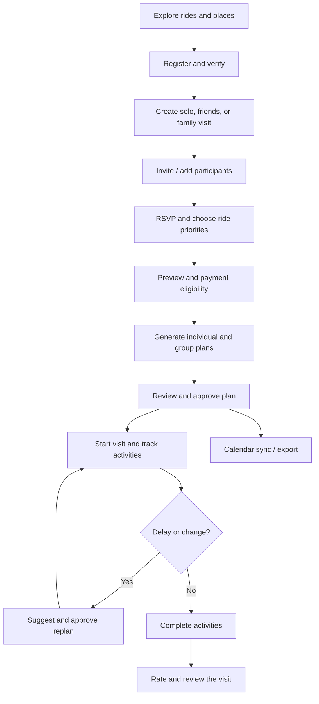
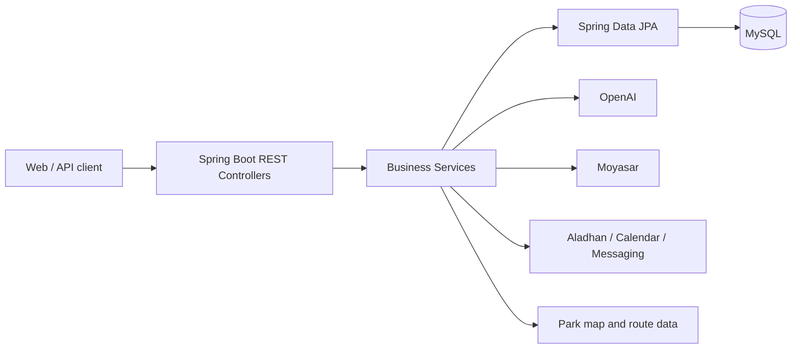

SIKKA | سكة 🎢
Your Qiddiya day, planned in minutes.
An AI-powered visit planner for Six Flags Qiddiya — built for solo visitors, friends, and families.

Overview · Features · User Journey · Architecture · API Overview · Contributions

Overview
SIKKA (سكة) helps visitors organize a full day at Six Flags Qiddiya. Instead of managing ride choices, queue times, walking distances, meals, and group decisions in separate places, Sikka brings them together in a coordinated visit plan.

The organizer creates a visit; friends or family participate and select rides; the backend checks ride restrictions; AI assists with individual and group itineraries; and the app supports approvals, progress tracking, GPS-assisted activities, alerts, and post-visit ratings.
Scope: Sikka plans park visits. It does not sell Six Flags admission tickets. Paid functionality refers to Sikka's planning service.

The Problem & Our Solution
Visitor challenge	Sikka's approach
Different interests and ride restrictions	Personal profiles, ride priorities, and eligibility checks
Difficult group coordination	Solo, friends, and family visits; invitations and participant management
Time lost to queues and walking	Itineraries informed by available waiting-time and map data
Meal and prayer breaks are overlooked	Scheduled dining breaks and prayer times
Schedules become outdated during the visit	Completion tracking, delays, and proposed replanning
Hard to recall what was completed	Per-member records, ratings, and progress summaries

Technology Stack
Layer	Technologies / integrations
Backend	Java 17, Spring Boot 4.1, REST controllers
Persistence	MySQL 8, Spring Data JPA / Hibernate
Authentication	Spring Security, session authentication, BCrypt
AI planning	OpenAI API, server-side itinerary validation
Park data & maps	Ride / place catalogue, park map and walking routes
Prayer times	Aladhan API
Payments	Moyasar sandbox, backend-side payment verification
Communication	Gmail SMTP, UltraMsg WhatsApp, n8n webhooks
Calendar	Google Calendar OAuth, manual Google link, Apple .ics export
QR invitations	ZXing
Testing & delivery	JUnit, Mockito, Maven Wrapper, Docker, GitHub Actions, Railway

Repository scope: This repository contains the Spring Boot backend. Do not assume a React frontend is included in this repository or that every external integration is live in production.
External APIs & Integrations
Service	Purpose	Implementation area
OpenAI API	AI-assisted individual/group plans and replanning	Planning services
Aladhan API	Prayer time lookup for scheduling	PrayerTimeService
Google Calendar API	OAuth connection and synchronization of approved plans	Calendar services
Gmail SMTP	Email verification and account messages	Email services
UltraMsg (WhatsApp)	Phone verification and messages	WhatsApp services
Moyasar API	Server-side payment confirmation	MoyasarService
n8n webhooks	Workflow-driven notification delivery	N8nNotificationService

Apple Calendar .ics exports, ZXing QR generation, browser GPS and local park routing are not separate external REST API providers. Provider setup and actual live delivery depend on credentials and deployment configuration.
Features
Accounts, profiles and group visits
- Account registration, email and optional phone verification, password recovery, authenticated profile management.
- Visit types: SOLO, FRIENDS, and FAMILY.
- Invitations through a code, QR code, or shareable link; RSVP and selected ride priorities.
- Family member profiles managed by the visit organizer.
- Free-visit allowance and server-verified payment for additional planning.
AI-assisted planning
- Individual and coordinated group itineraries.
- Three ride priorities: MUST_RIDE, PREFERRED, OPTIONAL.
- Eligibility and itinerary constraints evaluated by the backend — AI output is not a substitute for official ride safety rules.
- Ride availability, waiting times, walking routes, meals, snacks, and prayer-time considerations.
- Plan approval, subgroup coordination, meeting points, and proposed replanning.
During and after the visit
- Activity sessions started manually or through GPS-assisted flows.
- Family activity completion and per-member visit records.
- Delay notifications, current / next activities, and visit progress.
- Optional ratings and reviews for completed experiences.
- Calendar synchronization and export.
User Journey

Architecture

The Java code follows the project structure:
src/main/java/com/example/sikka/
├── Advice/       # Exception handling
├── Api/          # Common API response / exception
├── Config/       # Security and configuration
├── Controller/   # REST endpoints
├── DtoIn/        # Request DTOs
├── DtoOut/       # Response DTOs
├── Model/        # JPA entities
├── Repository/   # Database access
└── Service/      # Business logic and integrations
API Overview
The backend currently declares 168 REST endpoints across 22 controllers on the GitHub main branch (27 October 2026). These are source-code route counts, not a claim that every external integration has passed live end-to-end testing.

Contribution accounting: Each Model belongs to its original Git creator. Each API endpoint is credited to the developer who first implemented that route, even when it appears in another team member's Controller. Subsequent shared fixes and integrations are listed separately; contributor-specific endpoint totals will be published only after the route-level Git audit is complete.
Data Model
The project contains core models for visitors, visits, plans, park facilities, payments, messaging, and calendar sync. Examples include:
Domain	Models
Users & visits	Account, VisitorProfile, FamilyMember, Visit, VisitGroup, VisitMember
Planning	VisitPlan, PlanItem, PlanApproval, PlanHistory, VisitMealBreak
Live execution	ActivitySession, VisitRecord, Notification
Park & billing	Ride, Place, RidePreference, PaymentOrder, PrivacyConsent
Calendar integration	GoogleCalendarConnection, GoogleCalendarEvent, GoogleCalendarOAuthState

The current model inventory extends beyond the original 15-model team allocation. Always use the Model/ package for the current entity inventory rather than relying on the older ERD alone.
Abdulaziz Shafae Contributions
The routes below document controllers connected to Abdulaziz’s Models. They do not represent a verified count of routes personally created by Abdulaziz. Route-level Git attribution also includes contributions he made to other team members’ controllers and must exclude routes others introduced here.

Entities: VisitPlan, PlanItem, PlanApproval, PlanHistory, VisitRecord, ActivitySession, Notification, GoogleCalendarConnection, GoogleCalendarEvent, GoogleCalendarOAuthState.

Main work: individual and group visit planning, ride prioritization, subgroup coordination and meeting points, group approvals, live activity tracking, GPS updates, individual/family activity completion, ride ratings, visit progress, and replanning workflows. Meal-break workflows are integrated with Nawaf’s module.

AI: OpenAI-backed itinerary generation and proposed replanning, supported by server-side scheduling and ride-selection rules. The server validates constraints rather than relying on AI to determine ride safety or invent waiting times.

Integrations: Google Calendar OAuth 2.0 and plan synchronization, Apple Calendar export, Aladhan prayer times, park walking routes, and n8n notification delivery.

Notification work: in-app notifications, unread tracking, activity-delay alerts and responses, scheduled reminders, and external notification events.

Additional contributions: cross-flow integration, automated unit/integration/regression tests, family planning support, calendar-sync testing, and ensuring approved plans remain active until a proposed replan is accepted.

The features below belong to the planning and live-visit modules. Per-developer API counts are pending first-introduction Git attribution.
Extra endpoints
Method	Route
POST	/api/v1/activity-session/start/manual/{visitMemberId}/{planItemId}
POST	/api/v1/activity-session/complete/{activitySessionId}
PUT	/api/v1/activity-session/rate/{activitySessionId}
PUT	/api/v1/activity-session/location/{visitId}
POST	/api/v1/activity-session/start/gps/{visitMemberId}/{planItemId}
POST	/api/v1/activity-session/start/manual/family/{planItemId}
POST	/api/v1/activity-session/complete/family/{activitySessionId}
GET	/api/v1/notification/unread-count
PUT	/api/v1/notification/respond-delay/{notificationId}
POST	/api/v1/notification/check-delay/{activitySessionId}
POST	/api/v1/plan-approval/create/{visitPlanId}
PUT	/api/v1/plan-approval/approve
PUT	/api/v1/plan-approval/reject
PUT	/api/v1/plan-item/update/preferences
POST	/api/v1/visit-plan/create/individual/{visitId}
POST	/api/v1/visit-plan/create/group/{visitId}
GET	/api/v1/visit-plan/get/my-individual-plan/{visitId}
GET	/api/v1/visit-plan/get/approved-group-plan/{visitId}
GET	/api/v1/visit-plan/get/pending-group-plan/{visitId}
GET	/api/v1/visit-plan/meeting-points/{visitId}
GET	/api/v1/visit-plan/next-activity/{visitId}
GET	/api/v1/visit-plan/my-subgroup/{visitId}
GET	/api/v1/visit-plan/get/map-route/{visitPlanId}
POST	/api/v1/visit-record/complete/{visitId}
POST	/api/v1/visit-record/skip/{visitId}
PUT	/api/v1/visit-record/update/complete
PUT	/api/v1/visit-record/update/skip
PUT	/api/v1/visit-record/rate
GET	/api/v1/visit-record/visit-summary/{visitId}
GET	/api/v1/visit-record/progress/{visitId}

AI feature routes
Method	Route
POST	/api/v1/visit-plan/generate/{visitId}
POST	/api/v1/visit-plan/regenerate/group/{visitId}
POST	/api/v1/visit-plan/suggest-replan/{visitId}

Other API endpoints
Method	Route
GET	/api/v1/google-calendar/manual/{visitId}
GET	/api/v1/google-calendar/apple/{visitId}
GET	/api/v1/google-calendar/oauth/connect
GET	/api/v1/google-calendar/oauth/callback
GET	/api/v1/google-calendar/oauth/status
POST	/api/v1/google-calendar/sync/{visitId}
DELETE	/api/v1/google-calendar/sync/cancelled/{visitId}
DELETE	/api/v1/google-calendar/oauth/disconnect

Basic CRUD endpoints

View basic CRUD routes

Method	Route
GET	/api/v1/activity-session/history/{visitId}
GET	/api/v1/activity-session/current/{visitId}
GET	/api/v1/notification/get/my-notifications
GET	/api/v1/notification/get/details/{notificationId}
DELETE	/api/v1/notification/delete/{notificationId}
PUT	/api/v1/notification/read/{notificationId}
GET	/api/v1/plan-approval/get/{visitPlanId}
GET	/api/v1/plan-history/my-history
GET	/api/v1/plan-history/details/{planHistoryId}
GET	/api/v1/plan-item/get/items/{visitPlanId}
GET	/api/v1/plan-item/get/details/{planItemId}
GET	/api/v1/visit-plan/get/plans/{visitId}
GET	/api/v1/visit-plan/get/details/{visitPlanId}
DELETE	/api/v1/visit-plan/delete/{visitPlanId}
GET	/api/v1/visit-record/get/my-records/{visitId}

Mohammed Turki Contributions
Core entities: Account, VisitorProfile, VisitGroup, Visit, VisitMember. FamilyMember workflows are used in this flow, but Nawaf originally created that Model.

Main work: registration and account/profile management, email and phone verification, password recovery, individual/friends/family visit creation, group invitations, RSVP, ride selections, visit preview, check-in, and visit lifecycle management.

Integrations: Gmail SMTP for email verification, UltraMsg for WhatsApp verification and ZXing for invitation QR codes. The before-visit workflow uses verified payment status supplied by the payment module.

Additional contributions: session-security configuration, account and visit validation, frontend-facing visit contracts, and flow-level tests. Work shared across modules is not independently attributed here.
Nawaf Contributions
Core entities: Ride, RidePreference, Place, PaymentOrder, PrivacyConsent, FamilyMember, VisitMealBreak.

Main work: park ride and place catalogues, ride eligibility and restrictions, ride waiting-time/status management, visitor ride preferences, interactive map data, walking routes, privacy consents, payment-order operations, saved family members, and meal-break management.

Integrations: mapped ride/place data and walking-context endpoints, Moyasar payment verification, and park-data sourcing. Nawaf also introduced n8n notification integration services, shared with the notification flow.

Additional contributions: catalogue and eligibility validation, administrative ride management, and controller contracts used by AI planning and live activities.

SIKKA | سكة 🎢

Spend less time planning. Enjoy more of the ride.

